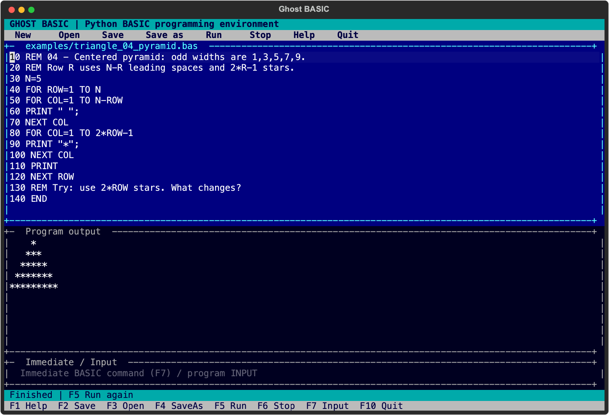
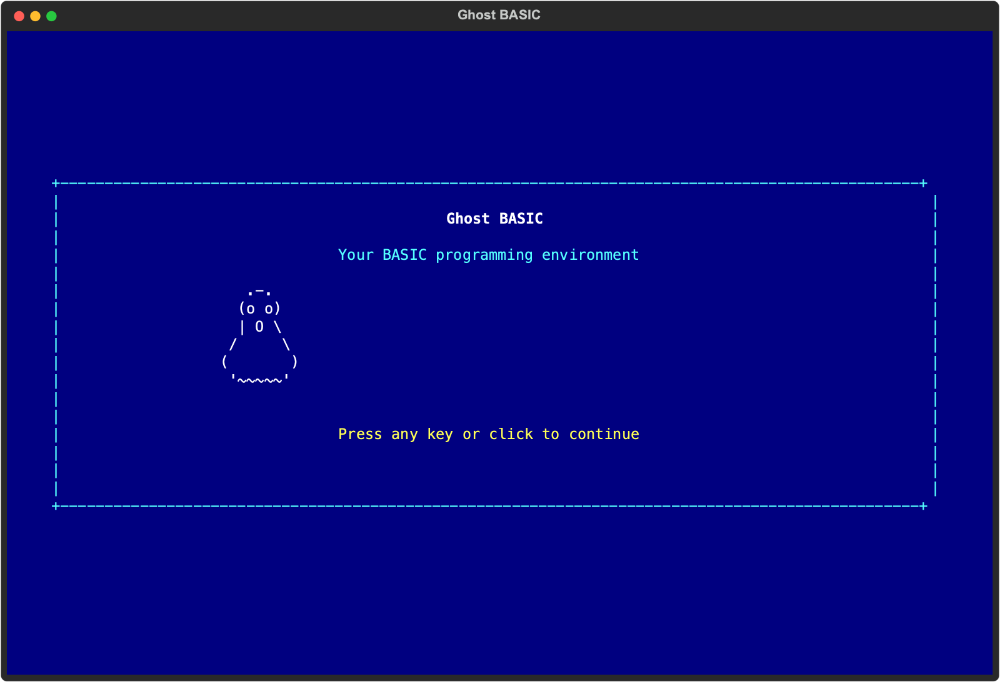
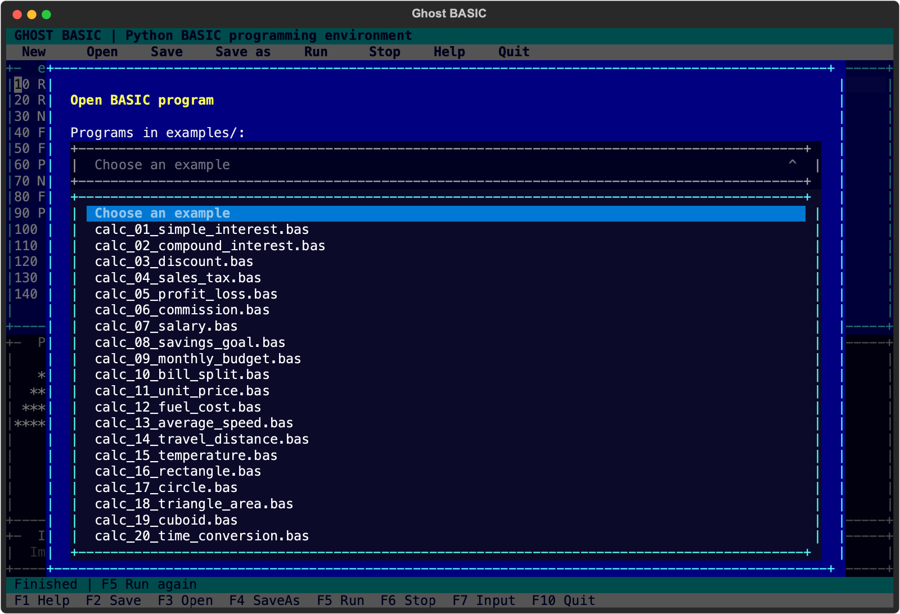
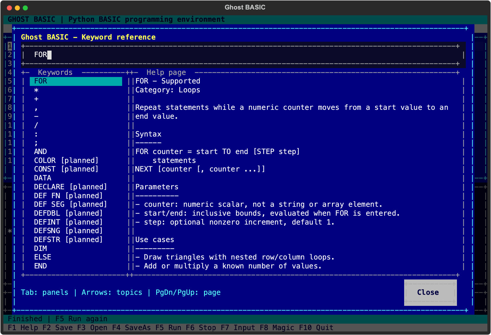

# Ghost BASIC

An independent MIT-licensed BASIC environment for Python 3.12+. Version 0.3 includes a
full-screen ASCII terminal editor, searchable keyword help and a tested BASIC interpreter.
It is **not yet a complete GW-BASIC or QBasic implementation**.

## Screenshots

Real captures of the running terminal application. The ghost moves in the app; its image
below shows one frame of the startup animation.

### Editor and program output



### Startup splash and flying ghost



<details>
<summary>See the examples picker and keyword help</summary>





</details>

The [landing page source](site/index.html) and [GitHub Pages deployment guide](docs/GITHUB_PAGES.md)
are included in this repository.

## Launch the terminal UI

After installation and activating the environment, launch from the project folder with:

```sh
GBASIC
```

The package installs both `GBASIC` and `ghost-basic` commands. You can also launch directly
with `.venv/bin/GBASIC` (Windows: `.venv\Scripts\GBASIC.exe`).

A startup splash displays **Ghost BASIC** with a flying ASCII ghost for about 5 seconds.
Press any key or click to go straight to the editor. Use `GBASIC --no-splash` to skip the
animation entirely. Batch programs and the classic shell start directly.

The ASCII UI opens by default in an interactive terminal. It includes a source editor,
program output panel, immediate command / INPUT field, clickable menus and keyboard shortcuts.

| Key | Action |
| --- | --- |
| F1 | Help |
| F2 / Ctrl+S | Save (asks for a filename for a new program) |
| F3 / Ctrl+O | Open a BASIC source file |
| F4 | Save as |
| F5 | Run the source in the editor |
| F6 / Ctrl+C | Stop a program, including one waiting for INPUT |
| F7 | Focus the immediate command / INPUT field |
| Ctrl+N | New program |
| F10 / Ctrl+Q | Quit |
| Tab / Shift+Tab | Move between controls; in the editor, Tab inserts indentation |

**Load a sample:** press **F3**, expand the examples dropdown with **Enter** (or click),
choose `fibonacci.bas` with the arrow keys, and press **Enter** to select it. Press
**Enter** again to open the selected file, then **F5** to run it. You can also type a
filename directly. The Open dialog uses 90% of the terminal width and height, and the expanded dropdown
grows with the terminal to show more filenames. Use arrow keys, mouse scrolling or type a
filename prefix to navigate. The dropdown refreshes on each Open, lists `.bas` files alphabetically
(case-insensitive), and stays disabled if the workspace has no examples. Source paths are relative to the workspace where you launched the
application. On keyboards that reserve function keys, use Fn+F3 / Fn+F5, the Ctrl shortcuts,
or click the menu buttons. Unsaved edits show `*`; New, Open and Quit ask before discarding.
Save as asks before replacing a different existing file.

The UI can open and edit numbered BASIC or unnumbered QBasic text. **Execution currently
requires numbered BASIC**; QBasic procedures are not implemented yet. Enter a simple example in the upper panel:

```basic
10 FOR I=1 TO 3
20 PRINT "Hello ";I
30 NEXT I
```

If a program uses INPUT, type its answer in the bottom field and press Enter. While idle,
that field accepts immediate statements and RUN, LIST, NEW, LOAD "file", SAVE "file", HELP
and SYSTEM. Run clears variables and arrays; immediate statements preserve them.

## Install in another checkout

```sh
python3 -m venv .venv
# Windows: .venv\Scripts\activate
source .venv/bin/activate
python -m pip install -e '.[dev]'
ghost-basic
```

Textual provides portable terminal editing/rendering. BASIC execution itself needs no AI,
server, browser or internet. Installing dependencies initially requires their packages.

## Other launch modes

```sh
ghost-basic --ide examples/hello.bas  # open a file in the ASCII editor
ghost-basic --shell                   # classic Ok prompt
python -m ghost_basic examples/hello.bas  # run a source file directly
```

Piped input defaults to the classic prompt; `--ide` requires an interactive terminal.
In `--shell`, insert or replace numbered lines, or enter a number alone to delete its line.
Use LOAD "file", LIST and RUN to load, inspect and execute a program.

LOAD and UI Open accept UTF-8 (with optional BOM) and fall back to DOS CP437 for
legacy text, including box-drawing characters and a trailing DOS Ctrl+Z marker. DOS/Windows
line endings are normalized. SAVE writes UTF-8; opening alone never converts the original
file on disk. Tokenized/protected and UTF-16 files remain unsupported. Other legacy
codepages cannot be reliably auto-detected.

LOAD/SAVE and UI file actions stay within `--root PATH` (current folder by default).
The explicit batch source path is read directly. `--max-steps 1000000` raises the default
100,000-instruction budget. UI execution also limits each run's output to 200,000 characters.
The UI supports 80x24 and larger terminals. Colors adapt to terminal capabilities; all frame
characters are ASCII. User source/output may contain Unicode. Screen modes, full syntax
highlighting, breakpoints and watches remain planned work.

## Logic-building examples

The examples dropdown includes ten commented triangle/pattern programs and sum, factorial
and prime exercises. Start with `triangle_01_left.bas`, then try the right-aligned, pyramid,
hollow, number, Floyd, Pascal and diamond patterns. Each includes a prediction challenge.
See the [learning guide](examples/README.md) for the progression and expected output.

## Input-based calculators

Open a `calc_` program with F3 and run with F5. Enter each requested number in the bottom
INPUT field and press Enter. There are 22 examples: simple/compound interest, discount,
sales tax, profit/loss, commission, salary, savings goal, monthly budget, bill splitting,
unit price, fuel cost, speed, distance, temperature, rectangle, circle, triangle area, cuboid,
time conversion, marks/grade and a fictional progressive electricity bill. Each has comments,
input checks and a practice challenge. See the [calculator guide](examples/CALCULATORS.md)
for input examples, expected answers, units and assumptions.

## Keyword help

Press **F1** to open the searchable offline reference. With the editor cursor on a keyword,
F1 starts on that keyword's page. Search for a name (`PRINT`, `MID$`) or a use case (`loop`).
Use Tab to switch panels, arrows to browse topics, and PageDown/PageUp to scroll the page.
Press Escape or F1 to return to the editor. The keyboard guide is the `KEYBOARD` topic.

Each of the **175 topics** has a description, syntax, parameters, use cases, examples,
expected output/effects and implementation notes. Every implemented statement, function,
operator and environment command is covered. Legacy features are marked **Not implemented**
and their examples are reference-only. This is not an exhaustive catalog of every BASIC dialect.

You can also enter `HELP PRINT` in the BASIC prompt or the UI command field, or run:

```sh
GBASIC --help-keyword PRINT
```

The same content is available as [offline Markdown pages](docs/keywords/INDEX.md).

## Development

```sh
python -m pytest
ruff check src tests
ruff format --check src tests
mypy
python -m build
```

[Architecture](ARCHITECTURE.md) · [Compatibility](COMPATIBILITY.md) ·
[Roadmap and phase tracker](ROADMAP.md) · [Testing](TESTING.md) ·
[Decisions](DECISIONS.md) · [Contributing](CONTRIBUTING.md)
